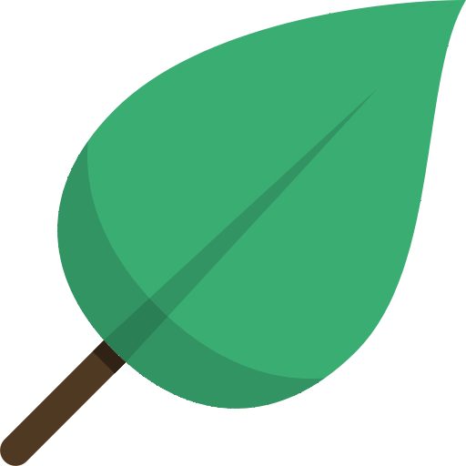

# leafpad

Leafpad is a simple notebook. Write, edit and organize your notes – offline, without an account and without access to your personal data.

## Features

**Private**
* Works completely offline, no cloud, no tracking
* Your notes are stored only on your device
* Hide notes from prying eyes
* Deleted notes are removed completely

**Write and format**
* Headings, bold, italic, underline and bullet lists
* Formatting bar above the keyboard while writing
* Read mode: notes open nicely formatted, tap "Edit" to change them
* Keep the screen on while reading, e.g. for recipes

**Organize**
* Categories with your own names and colors, as many per note as you like
* Pin important notes to the top
* Sort by date or title
* Switch between list and grid view
* Expand or collapse all notes at once
* Search in titles, text and categories

**More**
* Back up and restore all notes and categories as a ZIP file
* Share notes with other apps, or create notes from text shared with Leafpad
* Create a new note directly from the app icon (long-press)
* Light and dark theme
* Available in many languages – help translate on Weblate

Leafpad is free and open source software.

## Translation
Help translate at <a href='https://hosted.weblate.org/engage/leafpad/'>Weblate</a>

## Bugs or feature
If you have found a bug or are missing a function, you can simply open a new issue on GitHub.

<a href='https://github.com/amarradi/leafpad/issues/'>Post a GitHub Issue</a>

## Contributing
If you want to contribute leafpad you can read <a href='https://github.com/amarradi/leafpad/blob/development/CONTRIBUTING.md'>Contribute</a> and start.

## Support for leafpad
If you would like to support the work on leafpad, you are welcome to do so

via Paypal

<a href="https://www.paypal.com/pool/9rhXDhrRIV?sr=wccr">paypal.me/MarcusRadisch</a>

via Buy me a Coffee

via KO-FI

via Liberapay

Bitcoin (BTC): bc1qqpra3mk4zeufzwf6y6gpeaeaqsl3lp9fjfhjgx

Ethereum (ETH): 0x6071755459d98cAB41826656719Ae4707e5Dd000 

Stellst Lumen (XLM): GAN7UENINMC65PZBA5R5UV7TBZEWJWBG5OP34RI2FVTSUNTVALQTQQQE

Memo ID: 2755499291 

## Thanks
Many thanks for the ork for the leafpadproject goes to <a href='https://github.com/stdx'>@stdx</a>, <a href=https://github.com/sealor>@sealor</a>, <a href='https://github.com/alejandromartincarrera'>@alejandromartincarrera</a>, Manuel, Emil, Falk, Stephanie and many others

### Thanks for the translations
**Albanian**: Besnik Bleta(@Besnik_b); **Arabic**: Asaad Zein(@asaadzx); **Catalan**: Adolfo Jayme Barrientos(@Fito), Toni Gurguí(@tgurgui); **Chinese (Simplified Han script)**: 雲の中を漂う船(@KumoNoFune), imcc(@imcc); **Chinese (Traditional Han script)**: imcc(@imcc); **Czech**: MessingWithComputers(@MessingWithComputers); **Danish**: Isak(@Isak); **Dutch**: Bert Aarts(@OSSRocks); **English**: Yurt Page(@yurtpage), zergio inzunza(@n1kf4m3l), Santiago Centeno(@Java16); **Estonian**: Priit Jõerüüt(@jrthwlate); **French**: Leonart(@Leonart), Omgeta(@Omgeta), michte(@michte), David D.(@Dadu042); **German**: Blubberland(@Blubberland), Maximilian Hüttner(@MaxHue); **Gothic**: Roel v(@Hrothilas); **Greek**: Jim Kats(@jimkats1); **Hindi**: Harshit Sethi(@hstsethi); **Hindi (Latin script)**: Saurmanđal(@Saurmandal); **Indonesian**: Arif Budiman(@arifpedia), toposets(@toposets), Reza Almanda(@rezaalmanda), Antx(@antx); **Italian**: pastic cerre(@pasti), Akiakizero(@Akiakizero), Davide Secco(@davidesecco); **Polish**: Matthaiks(@Kityn), Krzysztof Kolumb(@Kolumb76), Eryk Michalak(@gnu-ewm), OskarO 140(@oskarek.o140); **Portuguese**: Lucas Alves Rego(@devlulcas), Ettlu selva rula(@Ttormor); **Russian**: Kirill Isakov(@crowbar), Yurt Page(@yurtpage), vanapro1(@vanapro1), Sotski Eugene(@jekakmail), MrSliv69(@MrSliv69), Steven Barash(@stevenbarash), Rachel Podya(@homicide@disroot.org), SnIPeRSnIPeR(@SnIPeRSnIPeR), Santiago Centeno(@Java16); **Serbian**: Nbjs(@nbjs); **Spanish**: Sofia Gutierrez(@SofiaIrina9), Zarahi Ander(@TradZarahi), Francisco Serrador(@fserrador), Santiago Centeno(@Java16), LittleWorm(@LittlerWorm), Marco(@Megido), Jose David M(@jposada202020@gmail.com), Francisco Gabriel Chardin(@FranChardin), Leopoldo Antonio Motto Murua(@leomotto), Abraham Mendoza(@1Alide1), zergio inzunza(@n1kf4m3l); **Swedish**: Luna Jernberg(@bittin)  **Tamil**: தமிழ்நேரம்(@TamilNeram), Kolappan N(@kolappan); **Ukrainian**: Максим Горпиніч(@Maksim2005UKR), Stepan Andriiovych(@Stepan); **Uzbek**: VoxB4(@voxb4)

### First version of leafpad
_Many thanks to Dominik Schmidt for providing the initial source code in 2017._

